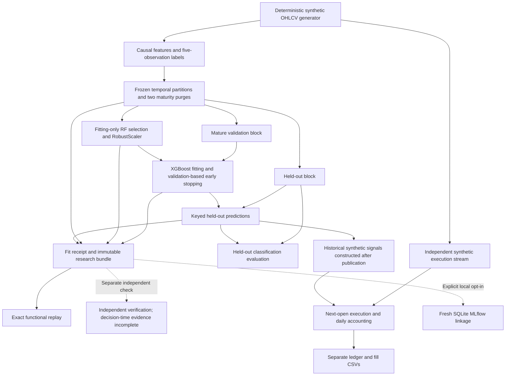

# APF Portfolio — Causal ML Research and Verifiable Artifacts

APF Portfolio is a synthetic quantitative machine learning research project demonstrating **causal temporal validation, XGBoost modeling, immutable research artifacts, and reproducible prediction replay**. A separate synthetic execution simulator makes cash, costs and portfolio accounting inspectable.

The supported demonstration uses **synthetic data only**. It is a research software portfolio, not production trading software or evidence of investment returns.

## Research problem

A reproducible ML result requires more than a seed and an accuracy score. Which observations trained the model? Were their labels mature? Did validation influence selection? Can an archived model reproduce the recorded probabilities? APF makes these questions explicit through frozen row identities, information cutoffs, fitted-state receipts and independently checked artifacts.

## Engineering and quantitative features

- Chronological fitting, validation and held-out memberships with **two label-maturity purge boundaries**.
- Random Forest feature selection and RobustScaler fitted on authorized fitting rows only.
- Three-class XGBoost with mature validation data for early stopping and keyed held-out probabilities.
- Receipt-bound model state, native booster export, immutable local publication and independent verification.
- Exact functional replay against saved keyed probabilities, with temporal evidence limitations reported separately.
- Optional, explicit local SQLite MLflow linkage and read-only tracking reconciliation.
- Independent synthetic execution prices, next-open fills, transaction costs, daily equity and completed-trade metrics.

## Architecture



The graph shows data dependencies, not parallel scheduling. In the example, classification evaluation follows signal construction and execution; held-out labels do not generate signals. Execution CSVs are produced **after publication and are not inside the immutable research bundle**. The independent bundle audit is a separate check, not an automatic claim of complete verification by the example.

See [architecture](docs/architecture.md) for the module boundaries and supported scope.

## Synthetic data and temporal validation

The example generates 180 artificial weekday sessions, with explicit UTC observation/open/close conventions and stable source-row identities. It does not use an authenticated exchange calendar or financial provider. Modeling observations and executable prices are generated separately; this separation tests software boundaries, not real-world source agreement or strategy alpha.

After feature warm-up and target-tail handling, the recorded fixture has **60 fitting / 5 first purge / 19 validation / 5 second purge / 55 held-out** rows. These sizes describe this frozen example only. The target is the five-observation forward return classified as **0 Down, 1 Neutral, 2 Up**, using a 0.5% threshold.

At each boundary, labels whose realization reaches the next protected block are purged. Selection and scaling fit only on the fitting block. Validation labels influence early stopping and therefore the model information cutoff. Held-out labels are used only for evaluation.

Observation time, feature availability, historical decision eligibility and actual batch generation are distinct. The fixture declares features available one minute after close and signals eligible two minutes after close; these are simulation assumptions, not measured historical availability. Per-prediction decisions are not retained in the V1 capture/bundle. See [temporal validation](docs/temporal_validation.md) and [limitations](docs/limitations.md).

## XGBoost modeling

The supported path trains a real `XGBClassifier`: histogram trees, three-class soft probabilities, 24 maximum estimators, depth 2, learning rate 0.1, seed 42, one thread and four-round validation early stopping. It captures estimator class ordering and exact held-out row identity; it does not silently truncate arrays or infer probability-column labels.

Inputs include closing price, lagged return, EMA, lagged volatility, lagged volume change and calendar day. The fitted selector determines the retained order. See [modeling](docs/modeling.md). Other forecasting families are not part of the validated demonstration; retained LightGBM and database compatibility code is outside its supported path.

## Evaluation and metrics

The example records a confusion matrix, accuracy and multiclass log loss on the held-out synthetic labels. These are fixture diagnostics, not estimates of real-world predictability. No financial-performance headline is presented.

The separate execution reporter calculates daily-equity return and risk metrics, completed-trade statistics, turnover and run completeness. It includes costs through cash/equity, uses initial capital in drawdown peaks and keeps daily and trade-level denominators distinct. Undefined ratios remain undefined; daily close marks do not measure intraday drawdown.

## Research receipts and immutable artifacts

A frozen protocol binds source artifacts, memberships, target settings and feature order. A post-fit receipt binds prepared inputs, fitted state, keyed capture and temporal metadata. Owned bundles are published locally without overwriting existing archives. Independent checks verify hashes, schemas, memberships and model/capture associations; content hashes do not authenticate authorship or witness historical training.

Only this run's fresh native booster artifact is loaded by the demonstration. Never use the example as an untrusted-model parsing sandbox. Source/receipt identities preserve exact state, which is stronger than—and different from—assuming two seeded refits have identical native storage.

## Exact functional replay

The recorded macOS Core run reproduced **55 predictions**, with **maximum probability difference 0.0** and **zero class mismatches**. This compares a saved fitted model with its own captured outputs; it does not independently reproduce training or certify cross-platform refitting.

Independent bundle verification remains **incomplete for decision-time evidence**, despite verified integrity/capture checks and successful numerical replay. This limitation is preserved deliberately.

## Optional local MLflow

Tracking is disabled by default. `--track-local` creates a fresh SQLite backend and artifact directory under a new explicit output root, then links an accepted bundle to research tracking metadata. Local client/linkage/reconciliation components are tested separately. The example does not contact a production tracking service or start an MLflow server. Tracking requires the optional dependency profile; Core validation did not install it.

See [execution and tracking](docs/execution_and_tracking.md).

## Synthetic execution accounting

The example maps Up to Long and other classes to Flat. Both `fixed_horizon` and `replace_next_open` use identical predictions, timestamps, synthetic prices, capital, costs and endpoint. Only position policy differs. Orders enter at the next session open, with five-session scheduled exits, 0.1% commission per filled side and 0.05% adverse slippage. Initial capital is 10,000 synthetic currency units with 50% allocation. Terminal liquidation is explicit.

The reusable engine also contains tested short/margin and lifecycle contracts; this **Long/Flat demonstration does not exercise every engine feature**. No real provider evidence, order routing, financing or investment suitability is claimed.

## Installation and quick start

The commands below are for the author or separately authorized reviewers, subject to applicable law and platform terms. Public viewing does not automatically authorize local execution. These instructions are technical documentation, not a general permission grant.

Recorded installed Core validation: **CPython 3.11.5, macOS arm64**. A reviewed 17-wheel offline set supported the demo: 16 external Core packages plus APF. This is narrower than a complete reproducible installation/build lock. Linux installation remains unsupported by executed evidence.

With that reviewed Core environment already installed and active, work **outside the source checkout** and use a new output path:

```bash
python -I -B -m examples.synthetic_research --output /tmp/apf-demo-new
```

With the separately reviewed tracking extra installed, use another new path:

```bash
python -I -B -m examples.synthetic_research --output /tmp/apf-demo-tracked-new --track-local
```

The equivalent installed entrypoint is `apf-synthetic`. Existing output directories are rejected. Demonstration execution blocks network activity and needs no credentials or real market data. Installation may require artifacts that are not locally available; no download is required or authorized merely by running the demo.

See [installation](docs/installation.md) for the distinction between Core, tracking, tests, legacy modules and currently incomplete locks. The commands above describe the supported interface, not a claim that training was rerun for this documentation update.

## Tests and reproducibility evidence

Historical evidence is separated by candidate and scope; these counts are **not added together**:

| Stage / candidate | Recorded environment and scope | Result |
|---|---|---|
| P3-B / v2 | CPython 3.11.5, macOS arm64; one full non-Linux pytest process | 1,335 passed; eight native cases deselected |
| P4-B / v3 | CPython 3.11.5, macOS arm64; one full non-Linux pytest process | 1,371 passed; eight native cases deselected |
| P4-D1 / v4 | Same platform; targeted offline regression selection | 356 passed; eight native cases deselected |
| P4-D2B / unchanged scientific wheel | Fresh offline macOS Core environment | 17 verified wheel inputs; install and `pip check` passed |
| P4-D2B / functional replay | Same saved synthetic fit; 55 held-out predictions | Maximum difference 0.0; zero class mismatches |
| P4-D2C / temporal evidence audit | Static/archive assessment | Expected incomplete decision-time evidence |
| P4-D3 / Linux readiness | No accessible Linux runtime | Zero of eight mandatory native cases executed |
| P5-D1 / v6 | CPython 3.11.5, macOS arm64; one consolidated pytest process, 32 modules | 1,447 passed; zero failures; eight native Linux tests deselected; 20 warnings |
| P5-D3 / v7 | Same platform; targeted rights/metadata checks | 120 passed; zero failures or warnings; 50 scientific files unchanged |
| P5-D4 / v8 | Same platform; targeted notice/metadata checks | 120 passed; zero failures or warnings; rights-reservation notice finalized |
| P5-E | Same platform; bounded source-release checks | 40 passed; zero failures or warnings; vulnerability status unverified |
| P6-A | Same platform; focused snapshot checks | 42 passed; zero failures or warnings; 112 files verified; 50 scientific files unchanged |
| P6-C1 | Same platform; automated documentation/source-integrity checks | 42 passed; zero failures or warnings; 50 scientific files unchanged |

P6-C1 changed only `README.md`, `docs/reproducibility.md` and `docs/test_matrix.md`; Mermaid structure was checked. GitHub Mermaid rendering was subsequently confirmed visually by the author, separately from the automated checks; this was not an automated rendering test.

These are separate historical validations, not tests rerun on the current GitHub commit. The additional v6 targeted selection passed 162 tests (14 warnings); it overlaps the full suite and is not an extra unique-test total. The independent CI pilot was **blocked by partial dependency locks**, not passed. Warnings were retained in the original runs. Full candidate tests require the reviewed development/tracking environment, not Core alone. The retained macOS checkout command is:

```bash
python -m pytest tests -k 'not native_linux'
```

This deselects eight native cases; it is not Linux validation. CI remains fail-closed on incomplete dependency evidence. Later targeted documentation, rights and snapshot checks do not replace the historical scientific run. See [reproducibility](docs/reproducibility.md) and [test matrix](docs/test_matrix.md).

## Known limitations

- No verified real-market historical point-in-time data or out-of-sample investment results.
- Incomplete archived per-prediction decision chronology; synthetic timestamps remain declarations.
- No native Linux validation or physical power-loss guarantee.
- macOS dependency locks are partial; Linux locks are unavailable; vulnerability status is unverified.
- No independently repeated hash-identical build or exact cross-refit training-state claim.
- Native model parsing and cooperative Python guards are not a hostile-code security boundary.
- Third-party license evidence gaps and source-rights qualifications remain documented; any public release requires separate author approval.

## Repository structure

```text
examples/synthetic_research.py   Supported offline experiment
src/features/                   Causal indicators and fitting-only selection
src/research/                   Protocol, receipt, bundle and functional replay
src/evaluation/execution/        Keyed capture, timing contracts, engine and metrics
src/tracking/                   Research linkage and read-only reconciliation
src/public_defaults/            Packaged safe defaults and source references
requirements/locks/              Partial/unavailable dependency evidence
scripts/                        Explicit validation and review tools
tests/                          Synthetic scientific and engineering checks
docs/                           Methodology, reproducibility and limitations
```

## Future research directions

Define versioned synthetic decision-time artifacts before extending verification claims; validate existing filesystem cases on actual Linux; complete dependency and vulnerability evidence; and assess any future real-data protocol with independently supported availability and execution provenance. These are future gates, not implemented validation results.

## Licensing status

The [rights-reservation notice](LICENSE) records **Copyright (c) 2026 Ochenash. All Rights Reserved.** It applies only to author-owned source and documentation. This is not an open-source release. Repository access does not expand the rights granted by the notice.

This repository presents the source for recruitment and professional evaluation, subject to its access controls. No general reuse, modification or redistribution permission is granted. Sublicensing or commercial exploitation requires separate written authorization, and local execution is not automatically authorized by this notice. Applicable law and platform terms remain controlling; the notice does not technically disable viewing, cloning or forking, or override GitHub's platform permissions.

Third-party components retain their own licenses and notices; the author's reservation does not relicense them. Synthetic research validation is not live-trading readiness or verified investment performance. Third-party obligations and applicable platform terms remain controlling. Any change to public visibility requires separate author approval.
